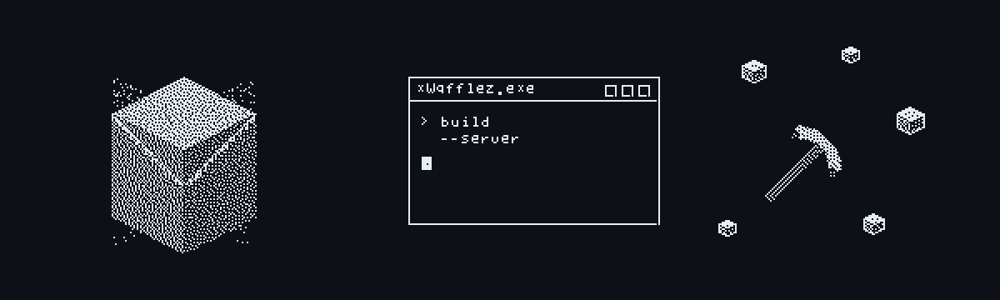
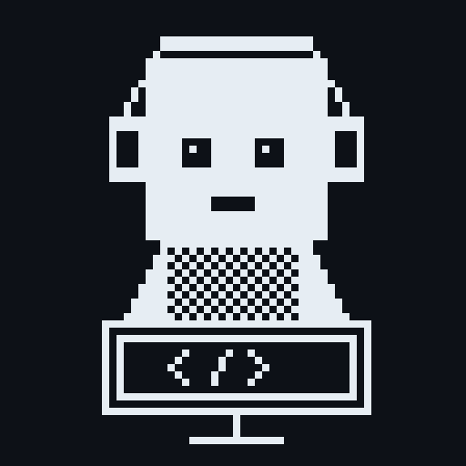

  

<h1 align="center">Hi 👋, I'm xWqfflez</h1>

<h3 align="center">Minecraft Developer & AI Engineer</h3>

  

Building public Minecraft servers, plugins and AI tools. Clipping when I'm not coding.

<h2 align="center">🚀 About Me</h2>

**xWqfflez** here. I've been making Minecraft content for **7 years**: plugins, server cores and the public servers they run on.

I also work as an **AI engineer**, building tools and automations on top of LLMs.

I run systems and the network at **KLAYZ.** and ship plugins like **UnstableCore**, **SMPCore**, **UnstableCrates** and **ChatColorsPlus**.

Outside of code I cut and edit clips, and I build my own tooling for it.

 

<h2 align="center">🤝 Connect</h2>

  
  &nbsp;
  

<h2 align="center">💻 Tech Stack</h2>

  
   
  

<h2 align="center">🧱 Projects</h2>

| Project | What it is |
| --- | --- |
| [**UnstableCore**](https://github.com/itswafflezlol/UnstableCore) | Core plugin for the Unstable server |
| [**UnstableCrates**](https://github.com/itswafflezlol/UnstableCrates) | Crate system for Unstable |
| [**SMPCore**](https://github.com/itswafflezlol/SMPCore) | Core plugin for SMP servers |
| [**ChatColorsPlus**](https://github.com/itswafflezlol/ChatColorsPlus) | Lightweight Bukkit/Spigot plugin for custom chat colors |
| [**VeloraPodiums**](https://github.com/itswafflezlol/VeloraPodiums) | Podiums for your gamemode's top players |
| [**KlayzGuard**](https://github.com/itswafflezlol/KlayzGuard) | Region protection and land claims |
| [**CorpseMod1**](https://github.com/itswafflezlol/CorpseMod1) | Corpse mod for Minecraft |
| [**WafflesPrefixMaker**](https://github.com/itswafflezlol/WafflesPrefixMaker) | Web tool for making rank prefixes |

<h2 align="center">📊 GitHub Stats</h2>

  

<h2 align="center">📈 Activity Graph</h2>

  

