<p align="center">
  
</p>

<h1 align="center">Hi 🧇, I'm xWqfflez</h1>

<h3 align="center">Minecraft Developer · AI Engineer · Clipper</h3>

<p align="center">
  <a href="https://xwqfflez.lol">
    
  </a>
</p>

<p align="center">
  <a href="https://xwqfflez.lol"></a>
  
  
  
</p>

<p align="center"></p>

<h2 align="center">🧇 About Me</h2>



Hey, **xWqfflez** here, also known as Waffles.

I've been building for **Minecraft for 7 years**. I write Paper plugins and Fabric mods, design server cores, and run **public servers** that real players log into every day.

I'm also an **AI engineer**. Right now I'm building AI tools for clippers, turning long streams into short vertical clips.

I handle systems and the network at **KLAYZ.**, an independent asset company, and in my free time I'm **clipping**: cutting and editing short-form content.

<br clear="right" />

```yaml
# plugin.yml
name: xWqfflez
main: me.xWqfflez.Developer
version: 7.0            # years of Minecraft dev
api-version: '1.21'
website: https://xwqfflez.lol
roles:
  - Minecraft developer   # Paper plugins, Fabric mods
  - AI engineer
  - Systems & network manager @ KLAYZ.
  - Clipper
servers: [UnstableMC]
fuel: waffles
```

<p align="center"></p>

<h2 align="center">🍯 What I Do</h2>

<table>
  <tr>
    <td align="center" width="33%">
      <br />
      <b>Minecraft Development</b>
    </td>
    <td align="center" width="33%">
      <br />
      <b>AI Engineering</b>
    </td>
    <td align="center" width="33%">
      <br />
      <b>Clipping</b>
    </td>
  </tr>
  <tr>
    <td valign="top">
      • Paper plugins on Java 21+<br />
      • Fabric mods for 1.21<br />
      • Server cores, crates, podiums, claims<br />
      • PlaceholderAPI, WorldGuard and WorldEdit hooks<br />
      • Public servers like UnstableMC
    </td>
    <td valign="top">
      • AI tools for clippers<br />
      • Finding the best moments in long streams<br />
      • Auto-crop to vertical and captions<br />
      • AI-written titles and hashtags<br />
      • Shipping with AI coding agents
    </td>
    <td valign="top">
      • Short vertical clips from streams<br />
      • YouTube and Twitch content<br />
      • Editing, captions and pacing<br />
      • Building my own clipping tools
    </td>
  </tr>
</table>

<p align="center"></p>

<h2 align="center">🛠️ Tech Stack</h2>

<p align="center"><b>Languages</b></p>
<p align="center">
  
</p>

<p align="center"><b>Build & Tools</b></p>
<p align="center">
  
</p>

<p align="center"><b>Minecraft</b></p>
<p align="center">
  
  
  
  
  
  
  
</p>

<p align="center"></p>

<h2 align="center">🧱 Projects</h2>

<div align="center">

| Project | Stack | What it is |
| --- | --- | --- |
| 🔒 **UnstableCore** | Paper · Maven | Core plugin for UnstableMC |
| 🔒 **UnstableCrates** | Paper · Java 21 | Crate system for UnstableMC |
| 🔒 **SMPCore** | Paper · Java 25 | Core plugin for SMP servers |
| 🔒 **VeloraPodiums** | Paper · Maven | Custom podiums for your gamemodes and events |
| 🔒 **CorpseMod1** | Fabric · 1.21.11 | Corpse mod for Fabric |
| [**ChatColorsPlus**](https://github.com/itswafflezlol/ChatColorsPlus) | Bukkit · Spigot | Lightweight chat color customization for admins and players |
| [**KlayzGuard**](https://github.com/itswafflezlol/KlayzGuard) | Java · fork | Region protection and land claims |
| [**KLAYZ.**](https://github.com/itswafflezlol/KLAYZ.) | HTML · CSS · JS | Animated coming-soon site for KLAYZ. |
| [**WafflesPrefixMaker**](https://github.com/itswafflezlol/WafflesPrefixMaker) | HTML | Rank prefix maker in the browser |
| [**xWqfflez.github.io**](https://github.com/itswafflezlol/xWqfflez.github.io) | HTML | Source for my website |

<sub>🔒 = private repo</sub>

</div>

<p align="center"></p>

<h2 align="center">🥞 The Stack So Far</h2>

<div align="center">

| Year | Layer |
| --- | --- |
| **2019** | Started making Minecraft stuff |
| **2024** | Joined GitHub |
| **2026** | Shipped ChatColorsPlus, UnstableCore, UnstableCrates and VeloraPodiums |
| **2026** | Joined KLAYZ., launched the KLAYZ. site, built SMPCore and CorpseMod1 |
| **Now** | Building AI tools for clippers |

</div>

<p align="center"></p>

<h2 align="center">📊 GitHub Stats</h2>

<p align="center">
  
</p>

<p align="center">
  
</p>

<p align="center">
  
</p>

<p align="center"></p>

<h2 align="center">🤝 Connect</h2>

<p align="center">
  <a href="https://xwqfflez.lol"></a>
  <a href="https://github.com/itswafflezlol"></a>
</p>

<p align="center">
  
</p>
